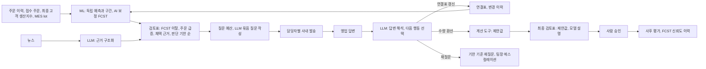

# 월간 수요검토 에이전트 프로토타입 v7 (가상 데이터)

LOTTE AX Challenge 2026 (롯데케미칼 첨단소재 수요예측 AI 기획) 기획안의 월간 흐름을 **가상 데이터와 실제 LLM**으로 끝까지 실행해 보는 프로그램입니다.

> **진행 중인 프로젝트입니다.** 본선(11/24~25) 준비에 맞춰 계속 갱신하고, 버전별 변경은 아래 변경 이력에 남깁니다.

## 한눈에 보기

| 역할 | 맡는 것 | 하는 일 |
| --- | --- | --- |
| **ML (숫자)** | LightGBM 전역 분위수 모델 외 | 고객 FCST 없이 만든 독립 예측과 80% 구간, 고객 FCST의 거래처별 편향을 학습해 고친 **AI 보정 FCST**, 수요 패턴 자동 분류와 패턴별 모델 자동 선택, 예측별 변수 기여도 |
| **LLM (말과 연결)** | Claude (Claude Code CLI, 구조화 출력) | 뉴스 구조화, 예측 설명, 담당 영업에게 보낼 확인 질문 작성, 답변 해석과 **다음 행동 선택**(연결표 갱신, 수량 환산, 재질문, 종결), 월간 브리핑 |
| **하네스** | `agent_harness.py` | 정해진 순서 실행, 권한 등급, JSON 스키마 강제, 숫자 근거 검증, 1회 재시도 후 규칙 대체, 호출 상한, 비용 기록, 기록 재생 |
| **계산 도구** | `tool_quantity` | 담당자가 확인한 사실(예: 11월부터 15% 감산)을 수량 제안으로 바꾸는 결정적 계산. LLM은 수량을 직접 쓰지 않음 |
| **사람** | 수요계획 담당자 | 승인. 승인값 기록 도구는 에이전트 권한 밖이며 실행 때마다 차단을 검사 |



## 결과 (현실형 가상 데이터, 기록 재생 실행본)

모든 수치는 `results` 폴더의 실행 결과와 같습니다. LLM은 Claude Haiku 계열(Claude Code CLI `--model haiku`)로 실제 호출했고, 그 입출력을 `llm_records`에 저장해 같은 결과를 재생합니다.

v7부터 가상 데이터를 **현실형**으로 바꿨습니다. v6까지의 데이터는 접수 주문이 "실제 주문량의 약 55%"로 거의 일정하고 고객 FCST도 "실제값 x 편향"이라, 모델이 답을 일부 보고 맞히는 구조였습니다. 현실형은 거래처마다 선주문 습관이 다르고(1개월 앞 접수 비율 30~75%), 월별 잡음과 접수 후 취소가 있으며, 고객 FCST가 지난 3개월 실적에 끌립니다. `DEMAND_DATA=designed`로 실행하면 이전 설계형으로 돌아갑니다.

### 1. 숫자: 설계형과 현실형, 접수 주문을 뺀 모델

최종 평가는 모델 선택에 쓰지 않은 마지막 6개 예측 시점입니다.

| 1개월 앞 WAPE | 기준(3개월 평균) | 접수 주문 뺀 LightGBM | 고객 FCST | 독립 예측 | AI 보정 FCST |
| --- | --- | --- | --- | --- | --- |
| 설계형 (v6 데이터) | 28.7% | 22.9% | 20.3% | 10.3% | 8.9% |
| **현실형 (v7)** | 28.7% | 22.9% | 25.4% | **14.8%** | **13.9%** |

| 현실형 WAPE | 고객 FCST | 독립 예측 | AI 보정 FCST | 80% 범위 적중률 |
| --- | --- | --- | --- | --- |
| 1개월 앞 | 25.4% | 14.8% | 13.9% | 86.1% |
| 2개월 앞 | 31.8% | 17.4% | 17.4% | 88.3% |
| 3개월 앞 | 36.3% | 21.1% | 21.7% | 82.2% |

- **접수 주문 정보가 성능의 큰 몫입니다.** 빼면 1개월 앞 오차가 14.8%에서 22.9%로 커집니다. 현장 데이터에서 접수 주문 이력을 예측 시점 기준으로 복원할 수 있는지가 가장 먼저 확인할 일입니다.
- **AI 보정 FCST는 1개월 앞에서만 독립 예측보다 낫습니다.** 고객 FCST가 지난 실적에 끌리면 그 안의 정보가 줄기 때문입니다. 모델 선택 구간에서는 1~3개월 모두 AI 보정이 나아 시작값으로 썼지만, 최종 평가 3개월 앞에서는 독립 예측과 비슷했습니다.
- 계층별 1개월 앞 WAPE는 거래처 x 그레이드 14.8%, 그레이드 9.1%, 제품군 7.5%입니다.
- 안정성 검사(현실형 데이터 6가지): 1개월 앞 WAPE 평균 고객 FCST 25.7%, 독립 예측 13.8%, AI 보정 FCST 12.4%, 접수 주문 뺀 모델 21.0%(편차 1~2%p). AI 보정은 18번 모두 고객 FCST보다 좋았지만(오차 평균 50~54% 감소), **독립 예측보다 나빴던 경우가 18번 중 5번** 있었습니다. 범위 적중률 평균 86~88%.
- **두 예측 중 무엇을 쓸지 규칙 3가지를 시험했지만 채택하지 않았습니다** (`forecast_engine.add_selected`). AI 보정이 진 5번은 모두 2~3개월 앞이었고 차이는 평균 0.2%p, 최대 0.6%p였습니다. 이긴 13번의 평균 차이는 1.1%p입니다. 그래서 둘 중 나은 쪽을 매번 미리 안다고 가정한 이상적인 경우와 AI 보정 하나만 쓴 경우의 차이가 평균 0.06%p뿐이었고, 고르는 규칙은 이 차이를 넘지 못했습니다.

| 1개월 앞 평균 WAPE (6개 데이터) | 값 | 독립 예측보다 나쁨 | AI 보정보다 나쁨 |
| --- | --- | --- | --- |
| AI 보정 FCST (채택) | 12.4% | 5/18 | - |
| 두 예측 평균 | 12.8% | 1/18 | 10/18 |
| 품목별 최근 3개월 오차로 선택 | 12.7% | 4/18 | 10/18 |
| 거래처별 최근 6개월 오차로 선택 | 12.5% | 2/18 | 7/18 |

(나쁨 건수는 예측 거리 1~3개월 x 데이터 6가지 = 18번 기준)

### 2. 예외 선별은 정말 틀릴 품목을 고르나

"큰 오차"는 고객 FCST 오차가 10톤 이상이면서 실적의 20% 이상인 경우입니다(현실형 데이터에서 전체의 48%). 매달 그달 안에서만 고르는 운영 방식으로 쟀습니다.

| 최종 평가 구간 | 검토 비율 | 정밀도 | 재현율 | 잡아낸 고객 FCST 오차 비중 |
| --- | --- | --- | --- | --- |
| v7 규칙: AI 보정 차이 상위 25% | 18.9% | 73.5% | 28.8% | 34.6% |
| 1단계 규칙: 독립 예측 차이 상위 25% | 18.9% | 76.5% | 30.0% | 36.7% |
| v6 규칙: 범위 이탈 + 10톤 | 20.9% | 75.2% | 32.7% | 31.8% |
| 같은 개수 무작위 | 20.9% | 49.6% | 21.5% | 25.8% |
| 같은 개수 물량 상위 | 20.9% | 49.6% | 21.5% | 32.1% |

- **세 규칙은 정밀도가 비슷하고(74~77%), 모두 무작위(50%)보다 약 1.5배 정확합니다.** 현실형 데이터 6가지 반복 평균도 정밀도 72~73%(무작위 46%, 물량 상위 53%)였습니다.
- **다만 잡아내는 오차 총량은 물량 상위 선택과 비슷합니다(약 36%).** 규칙의 강점은 오차를 더 많이 잡는 것이 아니라, 같은 검토 수에서 헛걸음(오차가 크지 않은 품목 검토)을 줄이는 데 있습니다. v7 규칙의 장점은 정확도보다 검토 물량을 예산으로 미리 정할 수 있다는 운영상 이점입니다.
- **재현율은 30% 안팎입니다.** 검토 예산을 20%에서 40%로 늘리면 잡아내는 오차 비중이 31%에서 44%로 올라갑니다(시트 20). 예산은 담당자 시간과 맞바꾸는 선택입니다.
- 앞 버전 설명에서 이 규칙의 정밀도를 86%로 적었던 것은 여러 예측 시점을 한꺼번에 놓고 순위를 매긴 계산이라 운영 방식과 달랐습니다. 위 표가 운영 방식으로 다시 잰 값입니다.

### 3. 말과 연결: LLM 작업과 하네스 검증

| 항목 | 결과 |
| --- | --- |
| 월간 루프 LLM 작업 | 근거 구조화 9, 담당자별 묶음 질문 7통, 답변 해석 21, 예측 설명 37, 브리핑 1 |
| 검증 | 1회 통과 70건, 재시도 후 통과 4건, 규칙 대체 0건 |
| 하네스가 잡은 실패 예 | 답변이나 입력에 없는 숫자를 넣은 해석과 후속 질문, 예측 설명의 "해야 합니다" 같은 지시 표현, 비현실적 변화율(150%) |
| 답변 해석 스트레스 시험 20건 | 필드 정답률 100%, **불확실한 답을 수량으로 바꾼 건 0/12**, 확실한 답을 수량 제안으로 바꾼 건 8/8 (150% 답은 재시도 후에도 형식이 맞지 않아 규칙으로 보류 처리) |
| 정확도 (가상 정답 대비) | 근거 구조화 필드 88.9%, 월간 루프 답변 해석 필드 97.3% |
| 비용 | 월 1회 실행 LLM 비용 0.130달러(스트레스 시험 포함) |

### 4. 업무 루프 (10월 회차)

| 항목 | 결과 |
| --- | --- |
| 검토 단위 | 90건, 1회차 수량 검토 대상 37건(41%), 판단 기한이 지난 작은 차이 10건은 알림만 |
| 질문 예산 | 담당자당 4품목, 영업 7명에게 묶음 메시지 7통으로 23품목 질문, 5품목은 다음 회차로 미룸 |
| 답변 반영 | 답변 21건 해석, 연결표 갱신 2건, 수량 제안 4품목, 재질문 3건(2건은 팀장 참조) |
| 답변 반영 후 | 승인만 남은 단위 29건, **사람이 직접 판단할 단위 8건 (9%)** |
| 선구매 확인 주제 | 4품목. 현실형 데이터에서는 접수 주문 잡음 때문에 선구매가 아닌 품목(D03)에도 질문이 붙었고, 영업 답변으로 걸러졌습니다 |

| 10월 회차 사후 평가 (가상 실적 2026-11 ~ 2027-01) | 고객 FCST | 독립 예측 | AI 보정 FCST | **에이전트 제안값** |
| --- | --- | --- | --- | --- |
| 전체 90건 | 37.2% | 18.6% | 20.7% | **17.2%** |
| 답변으로 사실이 확인된 품목 12건 | 26.5% | 24.5% | 25.3% | **10.1%** |

선구매 사례: D09의 11월 접수 주문이 평소보다 많은데 시장 생산지표는 전년과 비슷해 선구매 여부를 물었고, "12월 40톤, 1월 20톤 감소" 답을 받아 12월 제안값을 147.9 - 40 = 107.9톤으로 낮췄습니다(고객 FCST 196.9톤, 가상 실적 106.7톤).

### 5. 6개월 연속 회차: 쓸수록 나아지는가 (`multi_cycle.py`)

2026년 5~10월 6개 회차를 연속으로 돌렸습니다. 자유 문장 해석은 위 10월 회차와 스트레스 시험에서 따로 검증했으므로, 여기서는 가상 영업이 구조화된 답을 돌려줍니다(연결 질문 80% 답변, 수량 질문 75% 확인, 15% 보류, 10% 무응답). 같은 조건에서 연결표를 학습하지 않는 경우와 비교했습니다.

| 회차 | 5월 | 6월 | 7월 | 8월 | 9월 | 10월 |
| --- | --- | --- | --- | --- | --- | --- |
| 연결률 (학습) | 63% | 79% | 85% | 85% | 89% | 82% |
| 연결률 (학습 안 함) | 63% | 71% | 70% | 69% | 72% | 65% |
| 질문 품목 (학습) | 18 | 10 | 10 | 11 | 12 | 9 |
| 질문 품목 (학습 안 함) | 18 | 16 | 18 | 20 | 18 | 16 |
| 연결 확인이 필요한 품목 (학습) | 10 | 3 | 0 | 0 | 0 | 0 |

- **학습 효과는 주로 질문 감소(약 40%)와 최종 고객 가시성에서 나옵니다.** 연결된 품목이 최종 고객 생산지표를 입력으로 쓰게 되지만, 7~10월 평균 WAPE 개선은 독립 예측 18.9%에서 18.6%로 0.3%p에 그쳤습니다.
- 연결률이 10월에 내려간 것은 그달 주문량 구성이 바뀐 영향입니다(주문량 가중).

### 6. 예측 오차를 재고로 바꿔 보기, 접수 주문이 없는 현장

수요예측은 생산계획으로 쓰이므로, 오차를 "많이 잡아 남는 재고"와 "적게 잡아 모자란 양"으로 나눠 봤습니다. 최종 평가 구간에서 1개월 앞 값대로 다음 달을 생산했다고 가정하고, 일평균 수요로 나눠 일수로 환산했습니다(시트 22).

| 무엇대로 생산했나 | 초과 생산 (재고일수) | 부족 (일수) |
| --- | --- | --- |
| 고객 FCST | 1,740톤 (4.6일) | 1,122톤 (3.0일) |
| 독립 예측 | 774톤 (2.1일) | 898톤 (2.4일) |
| AI 보정 FCST | 808톤 (2.1일) | 759톤 (2.0일) |

**접수 주문 이력을 복원할 수 없는 현장(`DEMAND_NOACC=1`):** 1개월 앞 WAPE는 고객 FCST 25.4%, 독립 예측 23.5%, AI 보정 FCST 20.1%로, 이때는 고객 FCST 속 정보가 중요해져 AI 보정의 가치가 커집니다. 검토 정밀도는 72%로 유지됩니다. 재고는 초과가 4.6일에서 2.3일로 줄지만 부족이 3.0일에서 3.7일로 늘어, 모델이 수요를 낮게 잡는 쪽으로 치우칩니다. 이 경우 생산 기준값을 중앙값보다 조금 높은 분위수로 잡는 보정이 필요합니다.

**생산 기준값 보정:** 부족 1톤을 초과 재고 1톤보다 1.5배 비싸다고 보고, 시작값에 곱할 계수(0.95~1.15)를 모델 선택 구간에서 고릅니다(시트 22b). 접수 주문이 있으면 계수 1.00이 선택되고 비용지수(초과 + 1.5 x 부족, 일수)는 고객 FCST 9.10에서 5.17로 43% 낮습니다. 접수 주문이 없는 현장에서는 1.05가 선택되어 부족이 3.7일에서 3.1일로 줄고 비용지수는 7.80으로, 고객 FCST 대비 14% 낮습니다.

제안 시작값은 예측 거리별로 독립 예측, AI 보정, 둘의 평균 중 모델 선택 구간에서 가장 나은 것을 고릅니다(시트 21). 이번 데이터에서는 1~3개월 모두 AI 보정이 선택됐습니다.

### 7. 최종 고객사(End Customer) 수요 화면

예측은 주문이 들어오는 단위(직접 거래처 x 그레이드)로 하고, 그 결과를 **연결표를 따라 최종 고객과 산업, 제품군으로 묶어** 봅니다. 고객사가 늘어도 모델 수는 늘지 않습니다. 연결되지 않은 물량은 임의로 나누지 않고 미귀속으로 따로 둡니다(시트 23~25).

| 다음 달(2026-11) | 품목 | 고객 FCST | 독립 예측 (80% 범위, 근사) | 제안값 | 가상 실적 |
| --- | --- | --- | --- | --- | --- |
| 자동차, 완성차 A사 | 6 | 324톤 | 352톤 (313~390) | 326톤 | 272톤 |
| 자동차, 완성차 B사 | 3 | 379톤 | 277톤 (236~318) | 294톤 | 267톤 |
| 가전, 가전 C사 | 4 | 174톤 | 200톤 (176~224) | 199톤 | 171톤 |
| 가전, 가전 D사 | 4 | 235톤 | 264톤 (207~321) | 254톤 | 213톤 |
| IT기기, IT기기 E사 | 3 | 122톤 | 142톤 (80~205) | 136톤 | 119톤 |
| 의료기기, 의료기기 F사 | 2 | 44톤 | 58톤 (47~68) | 57톤 | 57톤 |
| 미귀속 (컴파운더, 대리점 경유 등) | 8 | 526톤 | 364톤 (297~430) | 398톤 | 382톤 |

- 최종 고객 단위로 묶은 3개월 WAPE: 고객 FCST 24.2%, 제안값 14.7%. 미귀속 물량은 독립 예측 기준 23%입니다.
- 제품군 x 산업 다음 달 제안값(톤): ABS 948(자동차 422, 가전 297, 미귀속 229), PC 426(미귀속 123, 가전 89, IT기기 86, 자동차 71, 의료기기 57), 컴파운드 290(자동차 127, 가전 67, IT기기 50, 미귀속 46).
- 범위는 품목별 범위를 서로 독립이라고 보고 합친 근사값입니다.
- **고객사가 많을 때:** 물량 상위 20~30개 핵심 고객은 회사별로 묶어 보고 생산 계획과 뉴스 근거를 회사 단위로 연결하며, 나머지는 "기타 자동차"처럼 산업별로 묶어 공개 산업 통계를 신호로 씁니다. 연결표는 외부 분석이 아니라 사내 그레이드 승인 이력, 영업 프로젝트, 납품처 기록으로 시작하고, 빈 곳은 에이전트 질문으로 채웁니다.
- 프로토타입의 최종 고객 6곳과 연결 관계는 가상입니다. 산업 구성(자동차, 가전, IT기기, 의료기기)은 공개 자료를 근거로 했습니다.

### 8. 회사를 특정 못 한 물량의 산업 추정 (`industry_mix.py`)

최종 고객 특정을 두 단계로 나눕니다. **회사까지 특정**은 연결표와 영업 질문으로, **산업까지만 특정**은 영업 질문 없이 데이터 단서로 합니다. 미귀속 물량을 산업별 수요에서 빼지 않고 근거와 함께 나눕니다(시트 26, 27).

후보 단서 4가지를 **정답 가림 검증**으로 비교했습니다. 정답을 아는 품목은 자기 연결 정보를 가린 채 산업을 맞히게 했습니다. 컴파운더 품목은 가상 데이터에서 6개 고객사 평균을 따르므로 정답 비중이 정해져 있습니다(10월 기준, 최초 연결표).

| 단서 | 단일 산업 품목 적중 | 연결표에 없는 품목 적중 | 컴파운더 비중 오차 | 최근 6개월 산업 배분 오차 |
| --- | --- | --- | --- | --- |
| 미특정 물량을 빼고 보기 (지금 방식) | - | - | - | 29.8% |
| 전체 비율로 나누기 | 42% | 33% | 10.3% | 11.0% |
| 주문 패턴 (산업 생산지수 결합 추정) | 46% | 33% | 31.2% | 25.9% |
| 그레이드 단서 | 29% | 33% | 25.0% | 11.5% |
| **거래처 단서 (채택, 없으면 전체 비율)** | **96%** | **100%** | **10.3%** | **6.0%** |

- **채택:** 같은 거래처의 연결된 다른 품목이 가는 산업 비율을 씁니다. 거래처 단서가 없는 컴파운더는 전체 비율로 나눕니다.
- **채택하지 않은 것:** 주문 패턴 추정은 산업 생산지수들이 같은 계절 흐름으로 움직여 구분이 안 됐고, 전체 비율보다 나빴습니다. 데이터가 더 길거나 산업 간 움직임 차이가 큰 실제 데이터에서 다시 시험합니다.
- **10월 회차 적용 결과:** 물량 기준 회사 특정 77%, 거래처 단서로 산업 추정 7%, 전체 비율 배분 16%(컴파운더). 산업 단위 3개월 실적 배분 오차는 미특정 제외 24.5%에서 6.6%로 줄었고, 산업 단위 3개월 WAPE는 고객 FCST 32.6%, 제안값 16.7%입니다.
- **컴파운더 물량:** 데이터 단서로는 전체 비율보다 낫게 나누지 못했습니다. 그래서 기획안에서는 주요 컴파운더와 연 1~2회 출하처 산업 비중을 함께 확인하는 협업 절차로 다룹니다.
- **스트레스 시험 (`industry_mix.stress_test`):** 가상 데이터는 거래처가 한두 고객사에 집중되도록 만들어져 거래처 단서에 유리합니다. 그래서 단일 고객 품목의 실제 고객을 확률 p로 다른 고객사로 바꾼 연결 구조를 200번씩 만들어 다시 쟀습니다(`output/산업추정_스트레스시험.csv`).

| 섞임 비율 | 가림 적중 | 배분 오차: 거래처 단서 | 배분 오차: 전체 비율 | 거래처 단서가 나은 경우 |
| --- | --- | --- | --- | --- |
| 0% | 90% | 6.0% | 10.2% | 100% |
| 20% | 63% | 10.0% | 11.5% | 77% |
| 40% | 47% | 11.2% | 11.6% | 58% |
| 60% | 34% | 13.9% | 13.2% | 37% |
| 80% | 29% | 13.8% | 13.3% | 47% |

- **도입 규칙:** 실제 데이터에서 연결된 품목으로 같은 가림 검증을 먼저 돌리고, 적중률이 60%에 못 미치면(섞임 약 20% 이상에 해당) 거래처 단서를 끄고 전체 비율 배분과 질문으로 돌아갑니다.

## 실행 방법

Python 3.10 이상, `pip install pandas numpy scikit-learn openpyxl lightgbm`

```powershell
python run_monthly_review.py                       # 기록이 있으면 재생, 없으면 Claude CLI 호출
python robustness.py                               # 현실형 데이터 6가지로 백테스트와 예외 선별 반복 (LLM 미사용)
python multi_cycle.py                              # 6개월 연속 회차, 연결표 학습 여부 비교 (LLM 미사용)
$env:DEMAND_AGENT_LLM="replay"; python run_monthly_review.py   # LLM 없이 기록만으로 재생
$env:DEMAND_AGENT_LLM="claude"; python run_monthly_review.py   # 기록을 무시하고 새로 호출
```

새로 호출하려면 Claude Code CLI(`claude`)가 설치되고 로그인돼 있어야 합니다. 결과는 `output` 폴더의 `실행_요약.txt`, `월간검토_결과_가상데이터.xlsx`(시트 31개), `검토화면.html`, `metrics.json`, 안정성 검사와 연속 회차 CSV입니다.

| 파일 | 내용 |
| --- | --- |
| `virtual_data.py` | 가상 코드 계층, 최종 고객 6곳(자동차, 가전, IT기기, 의료기기), 거래처 12곳(부품사, 사출업체, 완제품사, 컴파운더), MES lot, 뉴스와 답변, 정답 라벨 |
| `forecast_engine.py` | 패턴 분류, 후보 모델, 백테스트, 챔피언 선택, 구간 보정, 계층 집계 |
| `agent_harness.py` | 도구 등록과 권한, LLM 호출과 검증, 재시도, 기록 재생 |
| `run_monthly_review.py` | 월간 순서 실행과 결과 저장 |
| `review_ui.py` | 검토 화면 HTML 생성 |
| `robustness.py` | 시드별 반복 백테스트와 예외 선별 평가 |
| `multi_cycle.py` | 6개월 연속 회차 시뮬레이션 |
| `industry_mix.py` | 회사 미특정 물량의 산업 추정과 정답 가림 검증 |

## 한계 (정직하게 밝힐 것)

- **모든 데이터는 가상**이며 롯데케미칼의 실제 고객, 거래, 코드, 수치가 아닙니다. 숨은 변화(감산, 신모델, 선구매)와 답변도 일부러 만든 것이라 결과는 **기능이 의도대로 작동한다는 확인**이지 효과의 증명이 아닙니다.
- 영업 답변은 미리 써 둔 가상 문장이며, 질문을 받은 품목에만 도착하게 했습니다.
- 사후 평가의 제안값은 사람이 승인한 값이 아니라 에이전트가 제안한 값입니다.
- 모든 패턴의 챔피언이 LightGBM이었습니다. 스트레스 시험 답변도 미리 써 둔 가상 문장입니다.

## 만든 방식

| 본인 | AI (Claude) |
| --- | --- |
| 과제 분석, 기획안 설계, AI 역할 분담과 하네스 규칙 설계, 검증 항목 결정 | 설계대로 코드 작성 |
| 실행 결과를 원자료와 대조해 문제 확인: 검토 대상 과다, 간헐 품목의 월별 비교, 음수 감소량, 사실과 다른 질문 문장, 날짜 혼동 | 규칙과 검증기 수정 |
| 기록 재생으로 결과 재현 확인 | 결과 시트 구성 |

## 변경 이력

| 날짜 | 버전 | 내용 |
| --- | --- | --- |
| 2026-11-03 | v1 | 예선 기획안 기준 첫 공개. 가상 데이터, 예측구간 보정, 검토표, 근거 분류, 연결표 갱신, 사후 평가(모의 승인) |
| 2026-11-03 | v2 | 구간 보정의 시간 누수 차단, FCST 신뢰도 이력에 마감 실적만 사용, 점예측을 50% 분위수로 변경 |
| 2026-11-03 | v3 | 예측 기준일과 검토일 분리, 검토일 이후 공개 근거 제외 검사, 구간 신뢰도가 낮으면 구간 이탈만으로 검토하지 않음 |
| 2026-11-03 | v4 | 판단 기한 순 정렬과 확정 구간 알림, 선구매 확인 질문 규칙, 주문이 드문 품목의 구간 참고 규칙 |
| 2026-11-03 | v5 | **실제 LLM 연결과 하네스**(스키마, 숫자 근거 검증, 재시도, 권한, 기록 재생), 질문 발송과 답변 해석, 다음 행동 선택, 재질문과 에스컬레이션, 답변 사실의 수량 환산, AI 보정 FCST, 수요 패턴 분류와 모델 자동 선택, 코드 계층과 계층별 오차, MES lot 리드타임 기반 판단 기한, 다음 달 색상별 lot 계획, 선구매 사례, 산업과 거래처 유형 확대 |
| 2026-11-03 | v6 | 질문 예산(담당자당 상한, 우선순위, 다음 회차 이월)과 담당자별 묶음 메시지, 답변 해석 스트레스 시험 20건과 비현실적 변화율 검증, 범위 보정 수준을 모델 선택 구간에서 선택해 적중률 80% 이상, 변동과 덩어리 패턴 데이터, 시드 6개 안정성 검사, 검토 화면 HTML |
| 2026-11-03 | v7 | 현실형 가상 데이터(거래처별 선주문 습관, 잡음, 취소, FCST 관성)와 설계형 비교, 접수 주문을 뺀 모델 비교, 예외 선별의 정밀도와 재현율 평가와 검토 예산 규칙, FCST 이력이 없을 때의 1단계 규칙, 6개월 연속 회차와 학습 여부 비교. 앞 버전의 선별 정밀도 86% 설명을 운영 방식으로 다시 재서 정정. 재고 시뮬레이션, 예측 거리별 시작값 선택, 접수 주문 없는 현장 시나리오, 최종 고객별, 산업별, 제품군 x 산업 수요 화면 추가. 회사 미특정 물량의 산업 추정(거래처 단서 채택, 주문 패턴은 검증 후 미채택)과 연결 구조 스트레스 시험, 두 예측 선택 규칙 3가지 시험(미채택, AI 보정 유지) |

## 다음에 갱신할 것

- 판매 단가와 원료가 같은 가격 지표를 입력 후보로 넣고, 백테스트에서 개선될 때만 채택
- 그레이드 승인 이력과 영업 프로젝트 정보로 연결표 초기값 만들기
- 본선 현장 데이터 형식에 맞춘 입력 점검과 실행 절차
- 검토 화면의 승인 결과를 다음 회차 사후 평가에 자동으로 읽어 들이기
