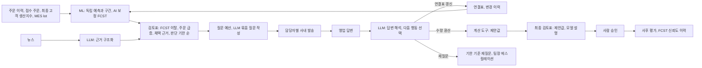

# 월간 수요검토 에이전트 프로토타입 v6 (가상 데이터)

LOTTE AX Challenge 2026 (롯데케미칼 첨단소재 수요예측 AI 기획) 기획안의 월간 흐름을 **가상 데이터와 실제 LLM**으로 끝까지 실행해 보는 프로그램입니다.

> **진행 중인 프로젝트입니다.** 본선(11/24~25) 준비에 맞춰 계속 갱신하고, 버전별 변경은 아래 변경 이력에 남깁니다.

## 한눈에 보기

| 역할 | 맡는 것 | 하는 일 |
| --- | --- | --- |
| **ML (숫자)** | LightGBM 전역 분위수 모델 외 | 고객 FCST 없이 만든 독립 예측과 80% 구간, 고객 FCST의 거래처별 편향을 학습해 고친 **AI 보정 FCST**, 수요 패턴 자동 분류와 패턴별 모델 자동 선택, 예측별 변수 기여도 |
| **LLM (말과 연결)** | Claude (Claude Code CLI, 구조화 출력) | 뉴스 구조화, 예측 설명, 담당 영업에게 보낼 확인 질문 작성, 답변 해석과 **다음 행동 선택**(연결표 갱신, 수량 환산, 재질문, 종결), 월간 브리핑 |
| **하네스** | `agent_harness.py` | 정해진 순서 실행, 권한 등급, JSON 스키마 강제, 숫자 근거 검증, 1회 재시도 후 규칙 대체, 호출 상한, 비용 기록, 기록 재생 |
| **계산 도구** | `tool_quantity` | 담당자가 확인한 사실(예: 11월부터 15% 감산)을 수량 제안으로 바꾸는 결정적 계산. LLM은 수량을 직접 쓰지 않음 |
| **사람** | 수요계획 담당자 | 승인. 승인값 기록 도구는 에이전트 권한 밖이며 실행 때마다 차단을 검사 |



## 결과 (가상 데이터, 기록 재생 실행본)

모든 수치는 `results` 폴더의 실행 결과와 같습니다. LLM은 Claude Haiku 계열(Claude Code CLI `--model haiku`)로 실제 호출했고, 그 입출력을 `llm_records`에 저장해 같은 결과를 재생합니다.

### 1. 숫자: AI 보정 FCST와 독립 예측
최종 평가는 모델 선택에 쓰지 않은 마지막 6개 예측 시점입니다.

| WAPE | 기준(3개월 평균) | 고객 FCST | 독립 예측 | **AI 보정 FCST** | 80% 범위 적중률 |
| --- | --- | --- | --- | --- | --- |
| 1개월 앞 | 28.7% | 20.3% | 10.3% | **8.9%** | 86.1% |
| 2개월 앞 | 31.0% | 21.7% | 15.0% | **11.5%** | 88.9% |
| 3개월 앞 | 36.4% | 25.7% | 20.5% | **15.6%** | 83.9% |

- **범위 보정 수준은 모델 선택 구간에서만 고릅니다.** 80%, 85%, 90% 중 선택 구간 적중률이 80%를 넘는 가장 낮은 수준(이번 실행 90%)을 쓰고, 최종 평가 구간은 보지 않습니다.
- **안정성 검사:** 가상 데이터를 6가지로 다시 만들어 반복했습니다. AI 보정 FCST의 고객 FCST 대비 오차 감소는 1, 2, 3개월 앞 평균 60%, 52%, 45%(편차 5~7%p), 범위 적중률 평균 85~89%이며, 18번 중 AI 보정이 고객 FCST보다 나빴던 경우와 독립 예측이 기준 모델보다 나빴던 경우는 모두 0번입니다. 숫자 자체는 가상 데이터라 기대치로 쓰지 않습니다.
- 수요 패턴을 예측 시점마다 이력으로 자동 분류(최종 평가 구간 기준 안정 20, 간헐 6, 변동 3, 신규 2, 덩어리 1품목, 시점에 따라 분류가 바뀐 품목 포함)하고 기준, Croston-SBA, LightGBM을 패턴별로 겨뤘습니다. 이 데이터에서는 접수 주문 정보 덕분에 모든 패턴에서 LightGBM이 이겼고, 실데이터에서 결과가 다르면 자동으로 바뀝니다.
- 같은 예측을 계층별로 합하면 1개월 앞 WAPE가 거래처 x 그레이드 10.3%, 그레이드 6.4%, 제품군 5.6%입니다.
- 판단 기한은 가상 MES lot 이력의 리드타임 80분위(AB-G10 21일 ~ CP-R60 48일)로 계산합니다.

### 2. 말과 연결: LLM 작업과 하네스 검증

| 항목 | 결과 |
| --- | --- |
| 월간 루프 LLM 작업 | 근거 구조화 9, 담당자별 묶음 질문 7통, 답변 해석 22, 예측 설명 33, 브리핑 1 |
| 검증 | 1회 통과 68건, 재시도 후 통과 3건, 규칙 대체 0건 |
| 하네스가 잡은 실패 예 | 답변에 없는 감소량(16.35톤, 3.59톤)을 스스로 계산해 넣음, 답변에 없는 최종 고객을 채움, 비현실적 변화율(150%)을 그대로 씀 |
| 답변 해석 스트레스 시험 20건 | 모호한 답, 무관한 답, 숫자 오류, 번복, 상대 시점, 영문 답을 섞음. 필드 정답률 100%, **불확실한 답을 수량으로 바꾼 건 0/12**, 확실한 답을 수량 제안으로 바꾼 건 8/8 |
| 정확도 (가상 정답 대비) | 근거 구조화 필드 88.9%, 월간 루프 답변 해석 필드 97.2% |
| 비용과 시간 | 월 1회 실행 LLM 비용 0.135달러(스트레스 시험 포함), 기록 재생 약 35초 |

### 3. 업무 루프: 사람과 영업의 부담

| 항목 | 결과 |
| --- | --- |
| 검토 단위 (거래처 x 그레이드 x 납기 월) | 90건 |
| 1회차 수량 검토 대상 | 34건 (38%), 판단 기한이 지난 구간의 작은 차이 7건은 알림만 |
| **질문 예산** | 담당자 1명당 한 회차 4품목 상한, 차이 물량, FCST 신뢰도, 선구매, 채택 근거로 우선순위. **담당자 7명에게 묶음 메시지 7통**으로 23품목 질문, 4품목은 다음 회차로 미룸 |
| 답변 반영 결과 | 답변 22건 해석, 연결표 갱신 2건, 수량 제안 4품목, 재질문 2건(1건은 팀장 참조) |
| 답변 반영 후 | **승인만 남은 단위 29건, 사람이 직접 판단할 단위 4건 (4%)** |
| 연결률 (직전 월 주문량 기준) | 65.2% → 70.8% |
| 검토 화면 | `results/검토화면.html`: 상태별 필터, 제안값과 계산식, 모델 설명, 답변을 보고 승인, 조정, 보류를 입력하고 CSV로 내보냄 |

### 4. 10월 회차 사후 평가 (가상 실적 2026-11 ~ 2027-01)

| 범위 | 고객 FCST | 독립 예측 | AI 보정 FCST | **에이전트 제안값** |
| --- | --- | --- | --- | --- |
| 전체 90건 | 25.7% | 16.2% | 12.9% | **10.3%** |
| 답변으로 사실이 확인된 품목 12건 | 25.0% | 22.0% | 19.8% | **8.7%** |

선구매 사례: D09의 11월 접수 주문이 평소보다 많은데 시장 생산지표는 전년과 비슷해 선구매 여부를 물었고, "12월 40톤, 1월 20톤 감소" 답을 받아 12월 제안값을 151.8 - 40 = 111.8톤으로 낮췄습니다(고객 FCST 187.9톤, 가상 실적 106.7톤).

## 실행 방법

Python 3.10 이상, `pip install pandas numpy scikit-learn openpyxl lightgbm`

```powershell
python run_monthly_review.py                       # 기록이 있으면 재생, 없으면 Claude CLI 호출
python robustness.py                               # 가상 데이터 6가지로 ML 백테스트 반복 (LLM 미사용)
$env:DEMAND_AGENT_LLM="replay"; python run_monthly_review.py   # LLM 없이 기록만으로 재생
$env:DEMAND_AGENT_LLM="claude"; python run_monthly_review.py   # 기록을 무시하고 새로 호출
```

새로 호출하려면 Claude Code CLI(`claude`)가 설치되고 로그인돼 있어야 합니다. 결과는 `output` 폴더의 `실행_요약.txt`, `월간검토_결과_가상데이터.xlsx`(시트 21개), `검토화면.html`, `metrics.json`, 안정성 검사 CSV입니다.

| 파일 | 내용 |
| --- | --- |
| `virtual_data.py` | 가상 코드 계층, 최종 고객 6곳(자동차, 가전, IT기기, 의료기기), 거래처 12곳(부품사, 사출업체, 완제품사, 컴파운더), MES lot, 뉴스와 답변, 정답 라벨 |
| `forecast_engine.py` | 패턴 분류, 후보 모델, 백테스트, 챔피언 선택, 구간 보정, 계층 집계 |
| `agent_harness.py` | 도구 등록과 권한, LLM 호출과 검증, 재시도, 기록 재생 |
| `run_monthly_review.py` | 월간 순서 실행과 결과 저장 |
| `review_ui.py` | 검토 화면 HTML 생성 |
| `robustness.py` | 시드별 반복 백테스트 |

## 한계 (정직하게 밝힐 것)

- **모든 데이터는 가상**이며 롯데케미칼의 실제 고객, 거래, 코드, 수치가 아닙니다. 숨은 변화(감산, 신모델, 선구매)와 답변도 일부러 만든 것이라 결과는 **기능이 의도대로 작동한다는 확인**이지 효과의 증명이 아닙니다.
- 영업 답변은 미리 써 둔 가상 문장이며, 질문을 받은 품목에만 도착하게 했습니다.
- 사후 평가의 제안값은 사람이 승인한 값이 아니라 에이전트가 제안한 값입니다.
- 모든 패턴의 챔피언이 LightGBM이었습니다. 스트레스 시험 답변도 미리 써 둔 가상 문장입니다.

## 만든 방식

| 본인 | AI (Claude) |
| --- | --- |
| 과제 분석, 기획안 설계, AI 역할 분담과 하네스 규칙 설계, 검증 항목 결정 | 설계대로 코드 작성 |
| 실행 결과를 원자료와 대조해 문제 확인: 검토 대상 과다, 간헐 품목의 월별 비교, 음수 감소량, 사실과 다른 질문 문장, 날짜 혼동 | 규칙과 검증기 수정 |
| 기록 재생으로 결과 재현 확인 | 결과 시트 구성 |

## 변경 이력

| 날짜 | 버전 | 내용 |
| --- | --- | --- |
| 2026-11-03 | v1 | 예선 기획안 기준 첫 공개. 가상 데이터, 예측구간 보정, 검토표, 근거 분류, 연결표 갱신, 사후 평가(모의 승인) |
| 2026-11-03 | v2 | 구간 보정의 시간 누수 차단, FCST 신뢰도 이력에 마감 실적만 사용, 점예측을 50% 분위수로 변경 |
| 2026-11-03 | v3 | 예측 기준일과 검토일 분리, 검토일 이후 공개 근거 제외 검사, 구간 신뢰도가 낮으면 구간 이탈만으로 검토하지 않음 |
| 2026-11-03 | v4 | 판단 기한 순 정렬과 확정 구간 알림, 선구매 확인 질문 규칙, 주문이 드문 품목의 구간 참고 규칙 |
| 2026-11-03 | v5 | **실제 LLM 연결과 하네스**(스키마, 숫자 근거 검증, 재시도, 권한, 기록 재생), 질문 발송과 답변 해석, 다음 행동 선택, 재질문과 에스컬레이션, 답변 사실의 수량 환산, AI 보정 FCST, 수요 패턴 분류와 모델 자동 선택, 코드 계층과 계층별 오차, MES lot 리드타임 기반 판단 기한, 다음 달 색상별 lot 계획, 선구매 사례, 산업과 거래처 유형 확대 |
| 2026-11-03 | v6 | 질문 예산(담당자당 상한, 우선순위, 다음 회차 이월)과 담당자별 묶음 메시지, 답변 해석 스트레스 시험 20건과 비현실적 변화율 검증, 범위 보정 수준을 모델 선택 구간에서 선택해 적중률 80% 이상, 변동과 덩어리 패턴 데이터, 시드 6개 안정성 검사, 검토 화면 HTML |

## 다음에 갱신할 것

- 판매 단가와 원료가 같은 가격 지표를 입력 후보로 넣고, 백테스트에서 개선될 때만 채택
- 그레이드 승인 이력과 영업 프로젝트 정보로 연결표 초기값 만들기
- 본선 현장 데이터 형식에 맞춘 입력 점검과 실행 절차
- 검토 화면의 승인 결과를 다음 회차 사후 평가에 자동으로 읽어 들이기
